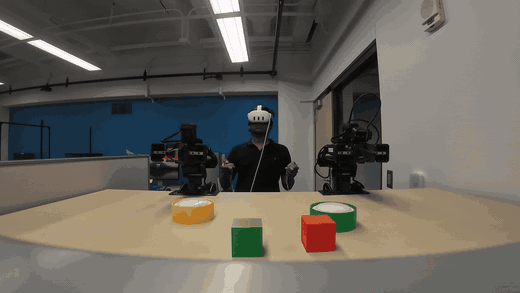
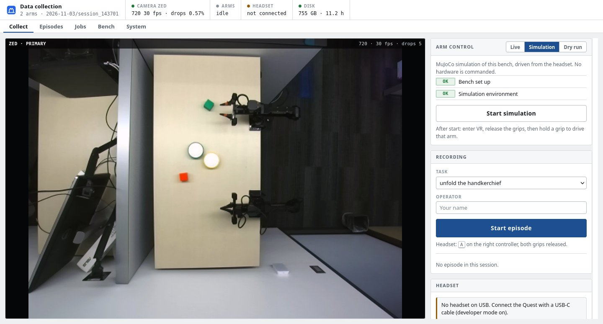
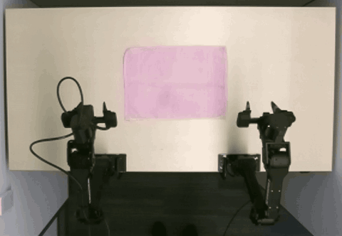
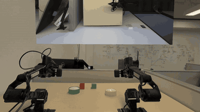
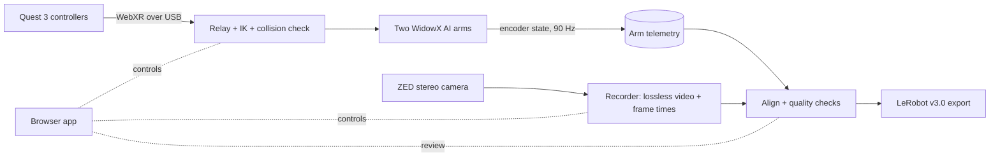

# bimanual-teleop-data-collection

**Meta Quest 3 teleoperation → synchronized robot data → LeRobot datasets, for two Trossen WidowX AI arms.**

- Teleoperate one or two arms with a Quest 3 (grip = deadman, collision-checked, 90 Hz control loop).
- Record a ZED stereo camera losslessly, timestamped against the arm log, with automatic quality checks per episode.
- Export accepted episodes as **LeRobot v3.0** datasets. Everything runs from one browser app with a safety checklist.

> Portfolio project, published for viewing. **Not open source: all rights reserved** (see [LICENSE](LICENSE)).

## In action

<em>Overhead ZED camera, the view that gets recorded: both grippers grab, fold and drag a cloth (2x speed)</em> 

<em>What the operator sees in the headset: passthrough, the live camera panel and the success prompt (3x speed)</em> 

## Architecture

More detail: [docs/architecture.md](docs/architecture.md).

## Measured on the real bench

| What | Result |
|---|---|
| Teleop control loop, two arms, recording on | **90 Hz**, 0 IK failures, send skew p99 1.3 ms |
| Camera-to-arm timing over a 105 s two-arm episode | **-2.5 ms** offset (correlation 0.85) |
| Camera recording | lossless stereo (FFV1) or ZED SDK SVO2; default 1080p at 15 fps, ~0% dropped frames |
| Crash safety | video flushed every second; a killed recording is recovered with at most ~1 s lost |
| Dataset | LeRobot v3.0 (checked with upstream LeRobot 0.4.3): 14-D state/action for two arms, stereo video, per-step flags |
| Quality gate | drops, torn frames, alignment, sync, length and label checks before an episode can be exported |
| Tests | 70 pipeline tests without any hardware (simulated arms, cameras, headset), plus the teleop suite (300+) |

## What I built

**Teleoperation (`teleop/`).** I started from an open-source, single-arm VR teleop kit written for a different robot
(see [Credits](#credits)) and ported it to the Trossen WidowX AI: the official robot model, Trossen driver
integration, the rest → home → rest lifecycle, task-frame calibration of the Quest controllers, physical safety
checks (deadman grip, joint tracking stop, reach limits, live confirmation token) and latency telemetry. Then I
extended it to **two arms**: both controllers in one WebXR packet, one combined MuJoCo collision check for both arms
every tick (with an optional table floor), coordinated fault handling so a problem on one arm holds both, and a
hold-X return to home.

**Data pipeline and app (`bimanual_collect/`).** Multi-camera recorder with crash recovery, camera/arm time
alignment and sync check, episode quality control and review, LeRobot exporter, depth from stereo (CPU and GPU;
ZED SDK SVO2 recording for its neural depth), and the browser app: bench setup wizard, arm run supervisor with checklist and single-interrupt Stop,
system doctor, one-click installer, printable operator card. Plus tests and CI.

**Stack:** Python, FastAPI/uvicorn, WebXR (Quest browser), MuJoCo, Trossen arm driver, V4L2 + ZED SDK, FFmpeg,
OpenCV, LeRobot, vanilla JS, GitHub Actions.

## What I'd do next

- Write the ZED SDK's neural depth into the exported datasets.
- Verify several cameras at once on hardware (wrist cameras).
- Train a policy on the collected episodes and report success rates.
- Measure and add the table geometry to the collision model.

## Run it

Needs the hardware (arms, Quest 3, ZED, Ubuntu 24.04). Setup steps: [docs/setup.md](docs/setup.md); other docs:
[troubleshooting](docs/troubleshooting.md), [configuration](docs/configuration.md),
[data format](docs/data_format.md). Without hardware, the simulation mode and `pytest` still run.

## Safety

The teleop stack keeps its own safety layers (deadman grip, joint tracking stop, combined collision check, reach
limits, live token). The app asks for confirmation before every live run and sends one interrupt on Stop. The arm
power switch is the emergency stop. Read the teleop documentation before driving real arms.

## Credits

- **Aurel Arnold**, [*VR Teleoperation Stack*](https://aurelarnold.xyz/blog/vr-teleoperation-stack/), and
  **[Dream Machines Robotics](https://github.com/Dream-Machines-Robotics/vr-teleop-kit)**, `vr-teleop-kit`: the basis of the teleop stack.
- **[Trossen Robotics](https://www.trossenrobotics.com/)**: WidowX AI arms, driver, models.
- **[Hugging Face LeRobot](https://github.com/huggingface/lerobot)**: dataset format and writer.
- **[Stereolabs](https://www.stereolabs.com/)**: ZED camera and SDK.

Third-party licenses: [THIRD_PARTY.md](THIRD_PARTY.md).

## License

Copyright (c) 2026 Apurv Kushwaha. All rights reserved. Published for viewing only.
