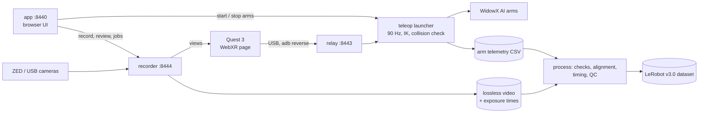

# Architecture

## Processes during a session

| Process | Port | What it does |
|---|---|---|
| **app** (`app.py`, the desktop icon or `python -m bimanual_collect app`, normal priority) | 8440, localhost | Serves the UI (`web/console/`); keeps the two services below running (`services.py`: adopts running copies, restarts crashed ones, retries the camera as soon as one is plugged in); forwards the UI's camera, episode and job requests to the camera service, so the page has one address; watches the headset over adb (`quest.py`); runs the bench wizard (`bench.py`); starts and stops the arm launchers (`arm_runner.py`). |
| camera service (`camera_server.py`, started by the app, nice 10) | 8444, localhost | Owns the recorded cameras through the **recorder** (`recorder.py`), serves their views to the headset page and the app, and hosts the episode/job API (`console.py`) and its job runner (`jobs.py`). Other cameras (e.g. RealSense wrist cameras not being recorded) go through the teleop repo's camera service code. |
| Quest page (`quest_page.py`, started by `session`) | 8443, localhost | The teleop repo's pose relay and WebXR page, served from a patched copy: native-resolution camera panels, a REC badge and a second header line (task, success prompt, warnings), A = start/stop, then A/B = success/failure. Patches must match the repo's text exactly, or start-up stops and names the patch. |
| teleop launcher (started by the app's arm runner, or from `teleop/` in a terminal) | - | Reads the controllers from the relay, maps them to each arm, solves IK, screens every command in one MuJoCo scene, sends to the drivers at 90 Hz, logs every tick to `teleop/runs/<date>/<run>/telemetry.csv`. |

The Quest reaches 8443 and 8444 through `adb reverse` over USB; nothing listens on the network. From another
machine, use an SSH port forward to 8440.

Why a separate app process: the camera service runs at nice 10 and a child inherits its parent's niceness (an
unprivileged process can't lower it again), so a launcher started from the camera service would run its 90 Hz loop
at low priority. The app runs at normal priority and is the launcher's parent; and Stop keeps working even if the
camera service is down. Services and launchers run in their own sessions with their output in log files, so
restarting or closing the app interrupts neither a recording nor an arm run; a new app picks them up again
(`state/arm_run.json` for the launcher, matched by pid and start time).

## The arm runner (`arm_runner.py`)

The teleop launchers have no control socket, so the runner drives them like a careful person at a terminal:

- **Start**: refused while any program that opens an arm driver session runs (launchers, preflights,
  `park_arms.py`, started by anyone). Live, first-run and read-only runs need the two human confirmations (arms at
  rest with nothing in reach; someone at the power switch) and the per-run checklist (bench saved, teleop profile
  checks and live gates, arms answer ping, workstation check, read-only check passed this session, headset on USB).
  The live token is built from the bench and shown in the dialog. A run that uses the headset waits (up to 2
  minutes) until the headset streams the right mode with both controllers tracked and both grips released, then
  launches: `<teleop>/.venv-arm19/bin/python -u scripts/run_dual_hardware.py --config configs/local/bench.yaml
  --live --confirm-live <token> --duration <cap> --label app-live`, in its own session, SIGINT at its default
  action (even if the app was started with it ignored), output to `state/logs/arms/<run>.log`.
- **Phase**: from the launcher's own lines (offline checks, waiting for controllers, connected, moving to home,
  home, live, stopping, returning, at rest); `SAFETY STOP: ...` and `EMERGENCY SHUTDOWN WARNING` are shown as
  errors whatever the exit code.
- **Live numbers**: the run's `telemetry.csv`, read incrementally once a second: loop rate, per arm tracked / grip /
  clutch / joint tracking error against the stop limit / IK misses, collision holds, time left.
- **Stop**: exactly one SIGINT, which makes the launcher return the arms to rest before closing the drivers. A
  second SIGINT during that shutdown, or SIGTERM / SIGKILL, would skip the return to rest, so the runner never sends
  anything else once the arms may have moved; if the launcher is still alive 20 s later the UI says to cut the power.
  "Force quit" exists only before any motion (stuck waiting or connecting).

## The bench (`bench.py`)

Saved in `configs/local/bench.json`; the teleop profiles are generated from the committed examples by replacing
values at YAML key paths (comments and every other setting kept): `bench.yaml` (the run profile) and, for two arms,
`bench_left.yaml` / `bench_right.yaml` (0.40 response, for the one-arm-at-a-time first-run check with the other arm
read-only). Arms are found and
watched with ping only; left and right are told apart by unplugging one arm's network cable. One-time root changes
(camera udev rule, system packages, the arm network address when NetworkManager refuses) go through
`scripts/system_setup_root.sh` under pkexec, i.e. Ubuntu's own password dialog.

## The recorder (`recorder.py`)

One `CameraWorker` per configured camera, each with three threads:

- **capture**: reads every frame over V4L2 (`zed_v4l2.py`: error-flagged and short buffers dropped and counted;
  sequence number and start-of-exposure time kept). If the camera stops delivering, the worker marks itself lost,
  tells the hub, and tries to reopen the device every 2 s (found again by serial; a replug can change `/dev/videoN`).
- **view**: JPEG of the middle 4:3 of the left eye (stereo) or the whole frame, at native pixels, only while someone
  watches (headset panel or console; a user count keeps one from switching the other off).
- **writer**: during an episode, the camera's exact bytes into FFmpeg (FFV1, one Matroska cluster per second,
  flushed per packet) and one `frames.csv` line per frame (flushed every 0.2 s).

The `Hub` runs the episode lifecycle for all cameras together:

- **start**: refuses if a camera isn't delivering or the disk is short; writes `episode.json` with
  `status: recording` (and the labels) before the first frame.
- **stop**: each writer finishes its queued frames and closes its encoder; `episode.json` is rewritten with the
  counters, `status` (`complete`, `aborted`) and `stop_reason`. Closing runs on its own thread, so a camera or
  encoder failure can trigger it safely.
- **monitor** (every 2 s): free disk (warning, then an automatic stop), arm activity (`activity.py`: a launcher
  process `<python> .../run_*.py` or a telemetry file still growing), queue depth; the warnings go to the console and
  the headset.
- **recovery**: on start, any episode still marked `recording` (a crash) is repaired by `recovery.py`: each video is
  remuxed, `frames.csv` trimmed to the frames that decode, the stop time filled in, `status: recovered`.

## One clock

- **Cameras:** each V4L2 buffer carries the kernel's start-of-exposure time on `CLOCK_MONOTONIC`.
- **Arms:** the teleop loop logs `pc_monotonic_ns` from `time.perf_counter_ns()` (`CLOCK_MONOTONIC` on Linux) and
  the read time of every encoder sample.
- **Matching a run to an episode:** both also log wall-clock time. A run belongs to an episode when its
  `epoch - monotonic` offset matches (same boot, within 1 s), its arm layout fits (`arms` in the rig config), and the
  time overlap is largest.

## Alignment (`lerobot_align.py`)

- One dataset step per **primary-camera** sequence number, at its rate. A dropped or torn primary frame keeps the
  previous image and sets `observation.frame_repeated = 1`.
- **Other cameras**: each step shows the frame nearest in exposure time; none within half that camera's frame period
  -> the previous frame, flagged in `observation.<camera>_frame_repeated`.
- **Arm layout** from the telemetry header: two arms (`left_` / `right_` columns, 14 values) or one (unprefixed,
  7 values).
- `observation.state`: per arm 6 measured joints [rad] + measured gripper [m], linearly interpolated to the step's
  exposure time, from **fresh** encoder reads only (the loop repeats the last read on ticks without a new one).
- `action`: per arm the last commanded 6 joints + gripper sent before that time.
- Steps more than 50 ms outside the arm log are trimmed; a gap of more than 100 ms inside the episode stops the
  alignment (not exportable).

## Sync check (`sync_check.py`)

Measures the camera-vs-arm offset from the content, independent of the timestamps:

1. Image motion: mean absolute luma change between consecutive primary frames inside the sync box (quarter
   resolution; the operator must be outside the box, because their motion leads the arms').
2. Arm motion: summed absolute joint change between the same two exposure times, from the encoders.
3. Correlate over shifts of -400 to +400 ms in 1 ms steps; the peak is the offset. Repeated on four time blocks.

QC (`catalog.py`) applies the rig's limits (default |offset| <= 15 ms with r >= 0.6).

## Torn frames (`frame_check.py`)

Some frames arrive full size and unflagged but wrapped sideways. The camera is fixed and most of the view is static,
so phase correlation of each frame's left-eye luma (quarter size) against the last good frame gives ~0 px; a torn
frame gives tens to hundreds. A shift that persists 4+ frames is treated as the view really moving.

## Depth (`episode_depth.py`, `calibration.py`)

- Rectification from the factory calibration: `R = Rodrigues([RX, CV, RZ])`, `T = (-Baseline, TY, TZ)` mm (checked
  by row alignment: 0 px median error). 2K and 1080p use OpenCV's valid-pixel rectification; 720p and VGA keep the
  camera's own focal length (the binned view is wider than the field the lens model was fitted on, so
  valid-pixel rectification would zoom in and scale depth wrongly).
- **SGBM**: OpenCV semi-global matching (3-way, block 5) on luma, per frame. Holes on dark, plain, one-eye areas.
- **RAFT**: torchvision's optical-flow network on the rectified colour pair at half size, both directions; dense,
  with a left-right consistency mask.

## Episode API and jobs (`console.py`, `jobs.py`)

A FastAPI router on the camera service (the app forwards it to the browser): status, MJPEG views, sessions and
episodes from the catalog, files inside the data folder only, review, rig summary and the box editor. Jobs (process,
export, depth) run one at a time as `python -m bimanual_collect ...` subprocesses at nice 10, each in the Python
environment it needs; the tools pause themselves while a recording or a hardware arm run is active.

## Load protection

The arm loop must keep 90 Hz and the cameras must not drop frames: the camera service runs at nice 10, and every
offline tool and job waits while a recording or a hardware arm launcher is active (`frame_check.wait_while_busy`).

## Testing without hardware

`pytest` runs everything offline: fake cameras, synthetic telemetry, fault injection in the recorder, and
`tests/fake_launcher.py`, which prints the arm launchers' phase lines and handles the stop signal the way they do.
For a manual run of the whole chain without arms or a headset: start the app, choose **Simulation** (or **Dry
run**), and stream two scripted controllers into the headset relay with `python tests/scripted_controllers.py
--seconds 60 --release-s 8` (grips released for the first 8 s, so the launcher's start check passes).
